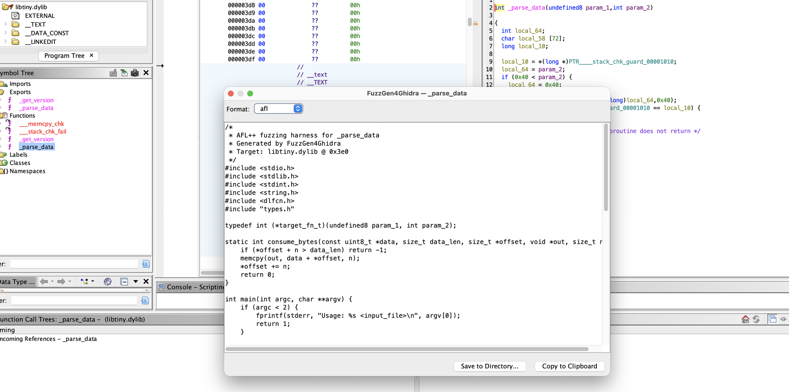
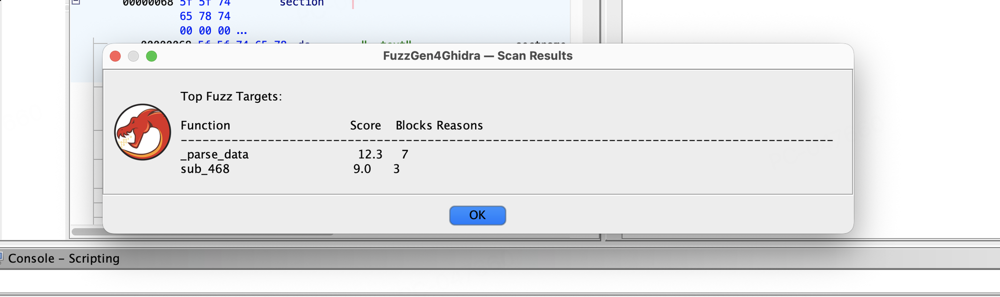

# FuzzGen4Ghidra

**Automatic fuzzing harness generation for Ghidra, powered by angr.**

[English](#english) | [中文](#中文)

---

## English

FuzzGen4Ghidra is a Ghidra extension that automatically generates AFL++ and libFuzzer fuzzing harnesses for binary functions. It combines Ghidra's decompiler for type recovery with angr's binary analysis for target scoring, producing ready-to-compile C harness code.

### Features

- **Target Scoring** — Scores every function in the binary on 4 axes: complexity, input surface, dangerous calls, and feasibility
- **Parameter Recovery** — Extracts parameter types from Ghidra's decompiler (buffer, int, struct pointer, function pointer)
- **Harness Generation** — Generates complete C harness code with input deserialization, `dlopen`/`dlsym` target loading, and a Makefile
- **Dual Format** — Supports both AFL++ (file-based) and libFuzzer (`LLVMFuzzerTestOneInput`) harness styles
- **Preview & Export** — In-Ghidra preview dialog with syntax highlighting, format switching, and save-to-directory

### Architecture

```
┌──────────────────────────┐         ┌──────────────────────────┐
│     Java Plugin          │         │     Python Engine         │
│     (Ghidra Extension)   │         │     (angr + Jinja2)      │
│                          │         │                          │
│  FuzzGen4GhidraPlugin    │  JSON   │  server.py               │
│  GenerateHarnessAction ──┼──line───┼─ engine.py (FuzzGenEngine)│
│  ScanTargetsAction       │  TCP    │  scorer.py (4-axis)      │
│  HarnessPreviewDialog    │ :13371  │  params.py (type recovery)│
│  EngineProtocol          │         │  harness.py (Jinja2)     │
│  EngineManager           │         │  protocol.py             │
└──────────────────────────┘         └──────────────────────────┘
```

### Pipeline

```
Load Binary → Scan & Score → Recover Params → Generate Harness
     │              │               │                 │
  angr.Project   CFGFast +       Ghidra          Jinja2 C
  auto_load=F    4-axis score    decompiler       templates
```

| Step | What happens |
|------|-------------|
| **1. Load** | Ghidra opens a binary; the plugin sends its path to the Python engine via TCP |
| **2. Scan** | angr builds a CFG, the scorer rates each function by complexity, danger, input surface, and feasibility |
| **3. Params** | Ghidra's decompiler extracts function signatures; the engine classifies each parameter (buffer, int, struct_ptr, func_ptr) and pairs buffer+length params |
| **4. Generate** | Jinja2 renders a complete C harness with input deserialization, a Makefile, a types header, and a seed corpus |

### Screenshots

<!-- Replace with real screenshots after installing in Ghidra -->

| Context Menu | Harness Preview | Scan Results |
|:---:|:---:|:---:|
|  |  |  |

> Screenshots are mockups. Replace with actual Ghidra screenshots after installation.

### Requirements

- **Ghidra** 11.0+ (tested with 11.4.3)
- **Java** 17+ (JDK 23 recommended)
- **Python** 3.10+ with:
  - `angr` 9.2+
  - `jinja2`
- **Gradle** 8.x (uses Ghidra's `buildExtension.gradle`)

### Installation

#### 1. Build the extension

```bash
cd FuzzGen4Ghidra

JAVA_HOME=/path/to/jdk \
  gradle buildExtension \
  -PGHIDRA_INSTALL_DIR=/path/to/ghidra_11.4.3_PUBLIC
```

This produces `dist/ghidra_*_FuzzGen4Ghidra.zip`.

#### 2. Install in Ghidra

1. Open Ghidra → **File** → **Install Extensions**
2. Click the **+** button, select the `.zip` file
3. Restart Ghidra
4. In CodeBrowser: **File** → **Configure** → Check **FuzzGen4Ghidra**

#### 3. Set up Python environment

```bash
# Create a venv with angr (recommended: in the parent directory)
python3 -m venv .venv
source .venv/bin/activate
pip install angr jinja2
```

The plugin automatically locates `.venv/bin/python3` by searching parent directories.

### Usage

#### Generate a harness for a specific function

1. Open a binary in Ghidra's CodeBrowser
2. Navigate to the target function in the Listing or Decompiler view
3. **Right-click** → **FuzzGen4Ghidra** → **Generate Fuzz Harness**
4. The Preview dialog opens with the generated C code
5. Switch between AFL++ / libFuzzer format using the dropdown
6. Click **Save to Directory** to export harness + Makefile + types.h + seed

#### Scan all functions for fuzz targets

1. Menu bar → **FuzzGen4Ghidra** → **Scan Fuzz Targets**
2. The engine scores every non-trivial function and returns a ranked list
3. Top targets show their score, block count, and reasons (dangerous calls, buffer params, etc.)

### Demo: Generating a harness

Given a function `parse_packet(const uint8_t *buf, int len)` that calls `memcpy`:

**Generated AFL++ harness (abbreviated):**

```c
/*
 * AFL++ fuzzing harness for parse_packet
 * Generated by FuzzGen4Ghidra
 * Target: libparser.so @ 0x401000
 */
#include <stdio.h>
#include <stdlib.h>
#include <stdint.h>
#include <string.h>
#include <dlfcn.h>
#include "types.h"

typedef int (*target_fn_t)(byte * buf, int len);

static int consume_bytes(const uint8_t *data, size_t data_len,
                        size_t *offset, void *out, size_t n) {
    if (*offset + n > data_len) return -1;
    memcpy(out, data + *offset, n);
    *offset += n;
    return 0;
}

int main(int argc, char **argv) {
    if (argc < 2) {
        fprintf(stderr, "Usage: %s <input_file>\n", argv[0]);
        return 1;
    }

    FILE *f = fopen(argv[1], "rb");
    /* ... read input into data buffer ... */

    void *lib = dlopen("./libparser.so", RTLD_LAZY);
    target_fn_t target = (target_fn_t)dlsym(lib, "parse_packet");

    size_t offset = 0;

    /* buf (buffer) */
    size_t buf_len = (data_len > offset) ? data_len - offset : 0;
    uint8_t *buf = (uint8_t *)(data + offset);

    target((byte *)buf, (int)buf_len);

    free(data);
    dlclose(lib);
    return 0;
}
```

**Then compile and fuzz:**

```bash
cd output_dir/
make           # builds with afl-gcc + ASan
make fuzz      # starts afl-fuzz with the seed corpus
```

### Target Scoring

Each function is scored on 4 weighted axes (0-100 each):

| Axis | Weight | What it measures |
|------|--------|-----------------|
| **Complexity** | 25% | Number of basic blocks (more blocks = more paths to explore) |
| **Input Surface** | 30% | Buffer parameters, calls to `read`/`recv`/`fgets`, parameter count |
| **Danger** | 25% | Calls to `memcpy`, `strcpy`, `sprintf`, `malloc`, `free`, etc. |
| **Feasibility** | 20% | Exported symbol, has parameters, reachable call depth |

### Running the engine standalone

The Python engine can be started independently for testing:

```bash
cd FuzzGen4Ghidra
PYTHONPATH=python python -m fuzzgen4ghidra_engine -v
# Listening on 127.0.0.1:13371
```

Send JSON commands via TCP:

```bash
echo '{"type":"init","params":{"binary_path":"/path/to/binary"}}' | nc 127.0.0.1 13371
```

### Tests

```bash
# Unit tests (no angr required)
PYTHONPATH=python python -m pytest test/ -v --ignore=test/test_integration.py

# Full suite including integration test (requires angr venv)
PYTHONPATH=python .venv/bin/python3 -m pytest test/ -v
```

25 tests covering protocol, models, scorer, params, harness generation, engine, and end-to-end integration.

### Project Structure

```
FuzzGen4Ghidra/
├── src/main/java/fuzzgen4ghidra/
│   ├── FuzzGen4GhidraPlugin.java      # Plugin entry point
│   ├── actions/
│   │   ├── GenerateHarnessAction.java  # Right-click → generate
│   │   └── ScanTargetsAction.java      # Menu → scan all
│   ├── engine/
│   │   ├── EngineProtocol.java         # Gson Command/Response
│   │   └── EngineManager.java          # Process + TCP management
│   └── ui/
│       └── HarnessPreviewDialog.java   # Code preview + export
├── python/fuzzgen4ghidra_engine/
│   ├── protocol.py       # JSON-line Command/Response
│   ├── models.py         # FuzzTarget, ParamInfo, ParamType
│   ├── scorer.py         # 4-axis fuzzability scoring
│   ├── params.py         # Ghidra signature → ParamInfo
│   ├── harness.py        # Jinja2 C code generation
│   ├── engine.py         # FuzzGenEngine orchestrator
│   ├── server.py         # TCP server on port 13371
│   └── templates/
│       ├── afl_harness.c.j2
│       ├── libfuzzer_harness.c.j2
│       ├── types.h.j2
│       └── Makefile.j2
├── test/                 # 25 tests
├── build.gradle
└── extension.properties
```

### License

Apache 2.0

---

## 中文

FuzzGen4Ghidra 是一个 Ghidra 扩展插件，能够自动为二进制函数生成 AFL++ 和 libFuzzer 的 fuzzing harness。它结合 Ghidra 反编译器的类型恢复能力和 angr 的二进制分析能力，生成可直接编译的 C 语言 harness 代码。

### 功能特性

- **目标评分** — 对二进制中的每个函数从 4 个维度评分：复杂度、输入面、危险调用、可行性
- **参数恢复** — 从 Ghidra 反编译器提取参数类型（buffer、int、结构体指针、函数指针）
- **Harness 生成** — 生成完整的 C harness 代码，包含输入反序列化、`dlopen`/`dlsym` 目标加载和 Makefile
- **双格式支持** — 同时支持 AFL++（基于文件）和 libFuzzer（`LLVMFuzzerTestOneInput`）两种 harness 风格
- **预览与导出** — Ghidra 内置预览对话框，支持语法高亮、格式切换、一键保存到目录

### 架构

插件采用 Java + Python 双进程架构，通过 JSON-line TCP 协议通信（端口 13371），与 [Ponce4Ghidra](https://github.com/user/Ponce4Ghidra) 同一模式：

- **Java 侧**（Ghidra 插件）：负责 UI 交互、反编译器调用、参数提取
- **Python 侧**（angr 引擎）：负责 CFG 分析、目标评分、harness 代码生成

### 评分机制

每个函数按 4 个加权维度评分（各 0-100 分）：

| 维度 | 权重 | 含义 |
|------|------|------|
| **复杂度** | 25% | 基本块数量（越多 = 越多路径可探索） |
| **输入面** | 30% | 是否有 buffer 参数、是否调用 `read`/`recv`/`fgets`、参数数量 |
| **危险度** | 25% | 是否调用 `memcpy`、`strcpy`、`sprintf`、`malloc`、`free` 等 |
| **可行性** | 20% | 是否为导出符号、是否有参数、调用深度 |

### 安装

#### 1. 编译扩展

```bash
cd FuzzGen4Ghidra

JAVA_HOME=/path/to/jdk \
  gradle buildExtension \
  -PGHIDRA_INSTALL_DIR=/path/to/ghidra
```

产出：`dist/ghidra_*_FuzzGen4Ghidra.zip`

#### 2. 安装到 Ghidra

1. 打开 Ghidra → **File** → **Install Extensions**
2. 点击 **+** 按钮，选择 `.zip` 文件
3. 重启 Ghidra
4. 在 CodeBrowser 中：**File** → **Configure** → 勾选 **FuzzGen4Ghidra**

#### 3. 配置 Python 环境

```bash
python3 -m venv .venv
source .venv/bin/activate
pip install angr jinja2
```

插件会自动在父目录中查找 `.venv/bin/python3`。

### 使用方法

#### 为指定函数生成 harness

1. 在 Ghidra CodeBrowser 中打开二进制文件
2. 在 Listing 或 Decompiler 视图中定位到目标函数
3. **右键** → **FuzzGen4Ghidra** → **Generate Fuzz Harness**
4. 预览对话框中查看生成的 C 代码
5. 用下拉框切换 AFL++ / libFuzzer 格式
6. 点击 **Save to Directory** 导出 harness + Makefile + types.h + 种子文件

#### 扫描所有函数的 fuzz 目标

1. 菜单栏 → **FuzzGen4Ghidra** → **Scan Fuzz Targets**
2. 引擎对每个非平凡函数评分，返回排序列表
3. 查看每个目标的评分、基本块数、评分原因

### 演示：从生成到 fuzzing

```bash
# 1. 在 Ghidra 中右键 parse_packet → Generate Fuzz Harness
#    → Save to Directory → 选择 output/

# 2. 编译并开始 fuzz
cd output/
make           # 用 afl-gcc + ASan 编译
make fuzz      # 启动 afl-fuzz，使用自动生成的种子语料

# 3. 或者用 libFuzzer
# 在预览对话框中切换格式为 libfuzzer，重新保存
make           # 用 clang -fsanitize=fuzzer 编译
make fuzz      # 启动 libFuzzer
```

### 测试

```bash
# 单元测试（不需要 angr）
PYTHONPATH=python python -m pytest test/ -v --ignore=test/test_integration.py

# 完整测试（需要 angr venv）
PYTHONPATH=python .venv/bin/python3 -m pytest test/ -v
# 25 passed ✓
```

### 许可证

Apache 2.0
