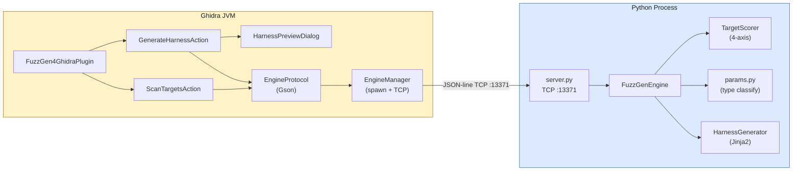
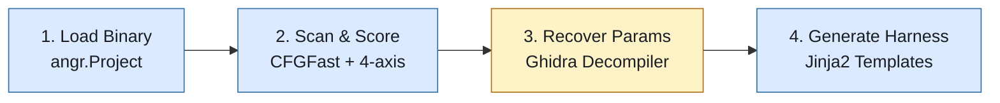
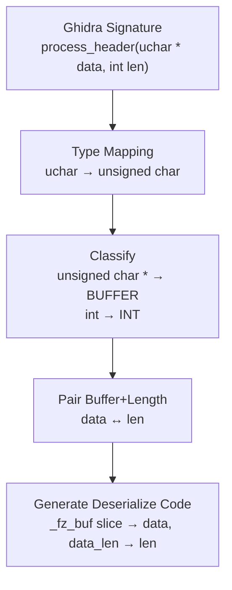

# FuzzGen4Ghidra

**Automatic fuzzing harness generation for Ghidra, powered by angr.**

[中文文档](README_CN.md)

---

FuzzGen4Ghidra is a Ghidra extension that automatically generates AFL++ and libFuzzer fuzzing harnesses for binary functions. It combines Ghidra's decompiler for type recovery with angr's binary analysis for target scoring, producing ready-to-compile C harness code.

### Features

- **Target Scoring** — Scores every function in the binary on 4 axes: complexity, input surface, dangerous calls, and feasibility
- **Parameter Recovery** — Extracts parameter types from Ghidra's decompiler (buffer, int, struct pointer, function pointer)
- **Harness Generation** — Generates complete C harness code with input deserialization, `dlopen`/`dlsym` target loading, and a Makefile
- **Dual Format** — Supports both AFL++ (file-based) and libFuzzer (`LLVMFuzzerTestOneInput`) harness styles
- **Preview & Export** — In-Ghidra preview dialog with syntax highlighting, format switching, and save-to-directory

### Architecture

> **Interactive architecture diagram**: [FuzzGen4Ghidra Architecture](https://claude.ai/artifact/Y1GPu6nQ324R8iweGPtK4B) — detailed diagrams with Mermaid, scoring examples, type mapping tables, and local testing guide.

The plugin uses a **Java + Python dual-process** design, communicating over JSON-line TCP (port 13371):



- **Java side** (Ghidra extension): UI interaction, decompiler access, function signature extraction
- **Python side** (angr engine): CFG analysis, target scoring, Jinja2 harness code generation
- **Why two processes?** Ghidra runs on JVM; angr is Python-native. TCP bridge avoids JNI/Jython complexity and allows standalone engine testing.

### Pipeline



| Step | What happens |
|------|-------------|
| **1. Load** | Plugin sends binary path to engine via TCP. Engine creates `angr.Project(path, auto_load_libs=False)`, returns arch and entry point |
| **2. Scan** | Engine runs `CFGFast()`, iterates `project.kb.functions`, scores each function on 4 axes. Streams progress via `{"status":"progress"}` messages |
| **3. Params** | Ghidra's `DecompInterface` extracts typed signatures. Engine classifies each param (`BUFFER`, `INT`, `STRUCT_PTR`, `FUNC_PTR`, `FLOAT`) and pairs buffer+length params by name heuristics |
| **4. Generate** | Jinja2 renders a complete C harness with `_fz_`-prefixed internal variables, Ghidra→C type mapping, a Makefile, types header, and seed corpus |

### Parameter Type Flow



| ParamType | Matches | Harness Behavior |
|-----------|---------|------------------|
| `BUFFER` | `void *`, `char *`, `uint8_t *`, `unsigned char *` | Consumes remaining fuzz data as pointer + length |
| `INT` | `int`, `uint32_t`, `size_t`, `undefined4`, ... | Reads N bytes via `consume_bytes()` |
| `FLOAT` | `float`, `double` | Reads `sizeof(type)` bytes |
| `STRUCT_PTR` | Any other `*` type (e.g. `kv_pair_t *`) | 256-byte stack buffer filled from fuzz data |
| `FUNC_PTR` | `code *` | Stubbed to `NULL` |

**Ghidra → C type mapping** (non-standard Ghidra names to valid C):

| Ghidra | C | Ghidra | C |
|--------|---|--------|---|
| `undefined` / `undefined1` | `uint8_t` | `uchar` | `unsigned char` |
| `undefined2` | `uint16_t` | `ushort` | `unsigned short` |
| `undefined4` | `uint32_t` | `uint` | `unsigned int` |
| `undefined8` | `uint64_t` | `byte` / `dword` | `uint8_t` / `uint32_t` |

Pointer types are split: `uchar *` → base `uchar` → `unsigned char` + suffix ` *` → `unsigned char *`.

### Screenshots

<!-- Replace with real screenshots after installing in Ghidra -->

| Harness Preview | Scan Results |
|:---:|:---:|
|  |  |

### Requirements

- **Ghidra** 11.0+ (tested with 11.4.3)
- **Java** 17+ (JDK 23 recommended)
- **Python** 3.10+ with:
  - `angr` 9.2+
  - `jinja2`
- **Gradle** 8.x (uses Ghidra's `buildExtension.gradle`)

### Installation

#### 1. Build the extension

```bash
cd FuzzGen4Ghidra

JAVA_HOME=/path/to/jdk \
  gradle buildExtension \
  -PGHIDRA_INSTALL_DIR=/path/to/ghidra_11.4.3_PUBLIC
```

This produces `dist/ghidra_*_FuzzGen4Ghidra.zip`.

#### 2. Install in Ghidra

1. Open Ghidra → **File** → **Install Extensions**
2. Click the **+** button, select the `.zip` file
3. Restart Ghidra
4. In CodeBrowser: **File** → **Configure** → Check **FuzzGen4Ghidra**

#### 3. Set up Python environment

```bash
# Create a venv with angr (recommended: in the parent directory)
python3 -m venv .venv
source .venv/bin/activate
pip install angr jinja2
```

The plugin automatically locates `.venv/bin/python3` by searching parent directories.

### Usage

#### Generate a harness for a specific function

1. Open a binary in Ghidra's CodeBrowser
2. Navigate to the target function in the Listing or Decompiler view
3. **Right-click** → **FuzzGen4Ghidra** → **Generate Fuzz Harness**
4. The Preview dialog opens with the generated C code
5. Switch between AFL++ / libFuzzer format using the dropdown
6. Click **Save to Directory** to export harness + Makefile + types.h + seed

#### Scan all functions for fuzz targets

1. Menu bar → **FuzzGen4Ghidra** → **Scan Fuzz Targets**
2. The engine scores every non-trivial function and returns a ranked list
3. Top targets show their score, block count, and reasons (dangerous calls, buffer params, etc.)

### Quick Start Walkthrough

A complete step-by-step guide from installation to fuzzing.

#### Step 1: Build and install the extension

```bash
# Build (replace paths with your actual paths)
cd FuzzGen4Ghidra
JAVA_HOME=/Library/Java/JavaVirtualMachines/jdk-23.jdk/Contents/Home \
  gradle buildExtension \
  -PGHIDRA_INSTALL_DIR=$HOME/ghidra_11.4.3_PUBLIC

# The zip is now in dist/
ls dist/ghidra_*_FuzzGen4Ghidra.zip
```

#### Step 2: Install in Ghidra

1. Launch Ghidra (run `ghidraRun` from the Ghidra install directory)
2. In the **Project Window**, go to **File → Install Extensions...**
3. Click the green **+** button in the top-right corner
4. Navigate to and select `dist/ghidra_*_FuzzGen4Ghidra.zip`
5. You should see **FuzzGen4Ghidra** appear in the extensions list with a checkbox
6. Click **OK**, then **restart Ghidra** when prompted

#### Step 3: Set up the Python engine environment

```bash
# Create a venv in the FuzzGen4Ghidra directory (or its parent)
cd FuzzGen4Ghidra
python3 -m venv .venv
source .venv/bin/activate
pip install angr jinja2
```

The Java plugin automatically searches for `.venv/bin/python3` starting from the project directory and walking up parent directories.

#### Step 4: Import a binary and enable the plugin

1. In the Ghidra Project Window, go to **File → Import File...**
2. Select a binary to analyze (e.g., a shared library like `libparser.so` or an ELF executable)
3. Accept the default import options and click **OK**
4. Double-click the imported file to open it in **CodeBrowser**
5. When prompted "Analyze now?", click **Yes** and accept the default analyzers — this runs Ghidra's auto-analysis including the decompiler
6. If the plugin is not yet enabled: go to **File → Configure...**, find the **FuzzGen4Ghidra** section, and check the box to enable it

After enabling, two new features appear:
- **Right-click context menu** → "FuzzGen4Ghidra" → "Generate Fuzz Harness"
- **Menu bar** → "FuzzGen4Ghidra" → "Scan Fuzz Targets"

#### Step 5: Scan for fuzz targets

1. In CodeBrowser, go to the menu bar: **FuzzGen4Ghidra → Scan Fuzz Targets**
2. The plugin starts the Python engine automatically (first run may take a few seconds)
3. A progress dialog shows the engine analyzing each function via angr's CFG
4. When complete, a results table appears showing the top-20 fuzz targets ranked by score
5. Each row shows: function name, address, overall score, block count, and scoring reasons

Use this to identify the best functions to fuzz — look for high scores with dangerous calls (`memcpy`, `strcpy`, etc.) and buffer parameters.

#### Step 6: Generate a fuzz harness

1. In the **Listing** or **Decompiler** view, click on the function you want to fuzz
2. **Right-click → FuzzGen4Ghidra → Generate Fuzz Harness**
3. The **Harness Preview** dialog opens with the generated C source code
4. Use the **Format** dropdown at the top to switch between:
   - **afl** — Generates a `main()` that reads from a file (for AFL++)
   - **libfuzzer** — Generates `LLVMFuzzerTestOneInput()` (for libFuzzer/LLVM)
5. Click **Copy to Clipboard** to copy the code, or
6. Click **Save to Directory...** to export all files to a folder:
   - `harness_<funcname>.c` — The harness source code
   - `types.h` — Type definitions for the target's parameters
   - `Makefile` — Ready-to-use build file for AFL++ or libFuzzer
   - `seeds/seed_000` — Initial seed corpus file

#### Step 7: Compile and run the fuzzer

```bash
cd output_dir/

# For AFL++:
make           # Compiles with afl-gcc and AddressSanitizer
make fuzz      # Starts afl-fuzz with the generated seed corpus

# For libFuzzer:
# (switch format to "libfuzzer" in the preview dialog and re-save)
make           # Compiles with clang -fsanitize=fuzzer,address
make fuzz      # Starts the libFuzzer binary
```

#### FAQ & Troubleshooting

**Q: "Failed to load binary: No module named 'angr'"**

The plugin found a Python interpreter but it doesn't have angr installed. Two solutions:

1. **Set `FUZZGEN_PYTHON` env var** (recommended): point it to the correct venv Python before launching Ghidra:
   ```bash
   export FUZZGEN_PYTHON="/path/to/your/.venv/bin/python3"
   /path/to/ghidra/ghidraRun
   ```
2. **Start the engine manually** in a terminal — the plugin will connect to it automatically:
   ```bash
   cd FuzzGen4Ghidra
   PYTHONPATH=python /path/to/.venv/bin/python3 -m fuzzgen4ghidra_engine -v
   # Then use the plugin in Ghidra as normal
   ```

**Q: "Binary not loaded — call init first"**

You triggered Scan from the **Project Window** instead of **CodeBrowser**. Double-click the binary to open it in CodeBrowser first, then use the plugin from there.

**Q: "Address already in use" when starting the engine manually**

A previous engine process is still running on port 13371. Kill it first:
```bash
lsof -ti :13371 | xargs kill
```

**Q: libFuzzer harness fails to link: `libclang_rt.fuzzer_osx.a not found`**

Apple's Xcode Clang doesn't include the libFuzzer runtime. Install LLVM via Homebrew:
```bash
brew install llvm
/opt/homebrew/opt/llvm/bin/clang -fsanitize=fuzzer,address -o harness harness.c -ldl
```

**Q: AFL harness fails: `afl-gcc: No such file or directory`**

AFL++ is not installed. Install it:
```bash
brew install aflplusplus
```
Or switch to libFuzzer format in the preview dialog (no AFL++ needed, just LLVM clang).

**Q: Harness compiles but crashes immediately with `dlopen` error**

The target library must be in the same directory as the harness (or in a path `dlopen` can find). Copy it:
```bash
cp /path/to/target.so ./   # same directory as the harness
```

| Other Problems | Solution |
|---------|----------|
| Engine takes a long time | angr's CFG analysis is CPU-intensive; large binaries take longer |
| No functions found in scan | The binary may be stripped or have no exported functions; try a shared library |
| "Generate Fuzz Harness" is greyed out | Make sure your cursor is positioned inside a function in the Listing/Decompiler view |

### Demo: Generating a harness

Given a function `parse_packet(const uint8_t *buf, int len)` that calls `memcpy`:

**Generated AFL++ harness (abbreviated):**

```c
/*
 * AFL++ fuzzing harness for parse_packet
 * Generated by FuzzGen4Ghidra
 * Target: libparser.so @ 0x401000
 */
#include <stdio.h>
#include <stdlib.h>
#include <stdint.h>
#include <string.h>
#include <dlfcn.h>
#include "types.h"

typedef int (*target_fn_t)(byte * buf, int len);

static int consume_bytes(const uint8_t *data, size_t data_len,
                        size_t *offset, void *out, size_t n) {
    if (*offset + n > data_len) return -1;
    memcpy(out, data + *offset, n);
    *offset += n;
    return 0;
}

int main(int argc, char **argv) {
    if (argc < 2) {
        fprintf(stderr, "Usage: %s <input_file>\n", argv[0]);
        return 1;
    }

    FILE *f = fopen(argv[1], "rb");
    /* ... read input into data buffer ... */

    void *lib = dlopen("./libparser.so", RTLD_LAZY);
    target_fn_t target = (target_fn_t)dlsym(lib, "parse_packet");

    size_t offset = 0;

    /* buf (buffer) */
    size_t buf_len = (data_len > offset) ? data_len - offset : 0;
    uint8_t *buf = (uint8_t *)(data + offset);

    target((byte *)buf, (int)buf_len);

    free(data);
    dlclose(lib);
    return 0;
}
```

**Then compile and fuzz:**

```bash
cd output_dir/
make           # builds with afl-gcc + ASan
make fuzz      # starts afl-fuzz with the seed corpus
```

### Target Scoring

Each function is scored on 4 weighted axes (0-100 each):

| Axis | Weight | What it measures |
|------|--------|-----------------|
| **Input Surface** | 30% | Buffer parameters, calls to `read`/`recv`/`fgets`, parameter count |
| **Complexity** | 25% | Number of basic blocks (more blocks = more paths to explore) |
| **Danger** | 25% | Calls to `memcpy`, `strcpy`, `sprintf`, `malloc`, `free`, etc. |
| **Feasibility** | 20% | Exported symbol, has parameters, reachable call depth |

**Real scoring example** (libdemo.dylib):

| Function | Score | Why |
|----------|-------|-----|
| `parse_kv` | **54.0** | Buffer param + `memcpy` + `strchr` + medium complexity |
| `process_header` | **49.0** | Buffer param + `memcpy` + struct parsing logic |
| `url_decode` | 9.0 | Has params but no dangerous calls |
| `get_api_version` | 2.0 | No params, trivial |

### Local Manual Testing (without Ghidra)

You can test the entire pipeline from the command line, bypassing Ghidra.

#### 1. Start the engine

```bash
cd FuzzGen4Ghidra
PYTHONPATH=python .venv/bin/python3 -m fuzzgen4ghidra_engine -v
# → Listening on 127.0.0.1:13371
```

#### 2. Send commands via nc

```bash
# Load a binary
echo '{"type":"init","params":{"binary_path":"/path/to/libdemo.dylib"}}' | nc 127.0.0.1 13371

# Scan targets
echo '{"type":"scan_targets","params":{"ghidra_functions":[]}}' | nc 127.0.0.1 13371

# Generate harness (with Ghidra-style signature)
echo '{"type":"generate_harness","params":{
  "func_addr":"0x5f0",
  "func_name":"process_header",
  "ghidra_signature":{"params":[
    {"name":"data","type":"uchar *","size":8},
    {"name":"len","type":"int","size":4}
  ]},
  "format":"libfuzzer"
}}' | nc 127.0.0.1 13371
```

#### 3. Compile the harness

```bash
cd output_dir/
cp /path/to/libdemo.dylib ./   # target library must be in same directory

# Option A: Full libFuzzer (requires Homebrew LLVM)
/opt/homebrew/opt/llvm/bin/clang -fsanitize=fuzzer,address -o harness harness_*.c -ldl

# Option B: Apple Clang + standalone driver (no LLVM needed)
# Create main_driver.c:
cat > main_driver.c << 'DRIVER'
#include <stdio.h>
#include <stdlib.h>
#include <stdint.h>
extern int LLVMFuzzerTestOneInput(const uint8_t *data, size_t size);
int main(int argc, char **argv) {
    if (argc < 2) { fprintf(stderr, "Usage: %s <input>\n", argv[0]); return 1; }
    FILE *f = fopen(argv[1], "rb");
    if (!f) { perror("fopen"); return 1; }
    fseek(f, 0, SEEK_END); long len = ftell(f); fseek(f, 0, SEEK_SET);
    uint8_t *buf = malloc(len); fread(buf, 1, len, f); fclose(f);
    int r = LLVMFuzzerTestOneInput(buf, len);
    printf("returned %d\n", r); free(buf); return 0;
}
DRIVER

clang -g -O0 -fsanitize=address,undefined -fno-omit-frame-pointer \
  -o harness harness_*.c main_driver.c -ldl
```

#### 4. Create test inputs and verify

```bash
# Create crafted inputs (example: process_header protocol)
python3 -c "
import struct
magic = b'\xDE\xAD\xBE\xEF'
v = b'\x01'
# Safe: payload_len=100, fits in buffer[512]
open('test_ok.bin','wb').write(magic + v + struct.pack('<H', 100) + b'A'*100)
# Crash: payload_len=1000, overflows buffer[512]
open('test_crash.bin','wb').write(magic + v + struct.pack('<H', 1000) + b'B'*1000)
"

# Run
./harness test_ok.bin        # → returned 0 (clean)
./harness test_crash.bin     # → ASan: stack-buffer-overflow in process_header!
```

**Expected ASan output for the crash input:**
```
ERROR: AddressSanitizer: stack-buffer-overflow on address ...
WRITE of size 1000 at ... thread T0
    #0 ... in __asan_memcpy
    #1 ... in process_header demo.c:17
    #2 ... in LLVMFuzzerTestOneInput harness_process_header.c:49
```

### PoC: Stack Overflow Exploitation Demo

The `demo/` directory contains a complete proof-of-concept demonstrating why `process_header`'s stack buffer overflow is critical-severity. The PoC escalates through 4 levels:

| Level | What happens | Result |
|-------|-------------|--------|
| **1. Normal** | payload_len=100, fits in buffer[512] | Clean return, no crash |
| **2. Overflow** | payload_len=600, overwrites 88 bytes past buffer | SIGSEGV — corrupted return address |
| **3. Controlled crash** | Return address overwritten with `0x4141414141414141` | SIGSEGV at attacker-chosen address |
| **4. Code execution** | Return address overwritten with `&you_got_pwned` | Attacker's function executes |

```bash
cd demo/
make          # builds libdemo.dylib (no protections) + poc_exploit
make poc      # runs the 4-level demo
```

**Expected output (Level 4):**
```
--- Level 4: Arbitrary code execution → you_got_pwned() ---
[*] Trying offset 536 ... returned 0 — no effect
[*] Trying offset 544 ... returned 0 — no effect
[*] Trying offset 552 ... 
  !!!!!!!!!!!!!!!!!!!!!!!!!!!!!!!!!!!!!!!!!!!!!!!!!!!
  !!  ARBITRARY CODE EXECUTION ACHIEVED            !!
  !!  Attacker hijacked process_header's return     !!
  !!  address to call this function.                !!
  !!!!!!!!!!!!!!!!!!!!!!!!!!!!!!!!!!!!!!!!!!!!!!!!!!!
SUCCESS! you_got_pwned() was executed!
```

**How it works:** The `process_header` function copies `payload_len` bytes (attacker-controlled `uint16_t`, 0–65535) into a 512-byte stack buffer via `memcpy`. At offset 552 from the buffer start, the return address lives on the stack. By writing a chosen address at that offset, the attacker controls where execution goes when `process_header` returns. See [PoC Walkthrough](#poc-walkthrough-how-the-exploit-works) below for the full technical breakdown.

### PoC Walkthrough: How the Exploit Works

#### The vulnerable code

```c
int process_header(const unsigned char *data, int len) {
    // ... magic + version checks ...
    uint16_t payload_len = data[5] | (data[6] << 8);  // attacker controls this
    char decompressed[512];                             // fixed-size stack buffer
    memcpy(decompressed, data + 7, payload_len);        // <-- THE BUG
    return (int)payload_len;
}
```

The bug: `payload_len` is read from the input packet (2 bytes, up to 65535), but `decompressed` is only 512 bytes. No bounds check.

#### The stack layout (x86_64, -O0, no stack protector)

```
           Low address
           ┌─────────────────────┐
  rbp-544  │ decompressed[0..511]│  ← memcpy destination
           │     (512 bytes)     │
           ├─────────────────────┤
  rbp-32   │ local vars          │  ← version, payload_len, etc.
           │     (32 bytes)      │
           ├─────────────────────┤
  rbp      │ saved RBP           │  ← caller's frame pointer (8 bytes)
           ├─────────────────────┤
  rbp+8    │ return address      │  ← WHERE TO JUMP ON `ret` (8 bytes)
           ├─────────────────────┤
           │ caller's frame ...  │
           └─────────────────────┘
           High address
```

Buffer start to return address = **552 bytes** (544 to saved rbp + 8).

#### Level-by-level exploit progression

**Level 1 — Normal (payload_len=100):**
```
Packet: [DE AD BE EF] [01] [64 00] [AAA...100 bytes]
        magic          ver  len=100  payload

memcpy writes 100 bytes into decompressed[512] → fits, no overflow.
```

**Level 2 — Overflow (payload_len=600):**
```
Packet: [DE AD BE EF] [01] [58 02] [pattern...600 bytes]
                             len=600

memcpy writes 600 bytes:
  bytes 0-511:   fill decompressed[] ← OK
  bytes 512-543: overwrite local vars ← corrupted
  bytes 544-551: overwrite saved RBP ← corrupted
  bytes 552-559: overwrite return address ← CORRUPTED
  bytes 560-599: overwrite caller's stack ← corrupted

When process_header executes `ret`, CPU jumps to the garbage
in the corrupted return address → SIGSEGV.
```

**Level 3 — Controlled crash (all 0x41):**
```
Packet: [DE AD BE EF] [01] [44 02] [0x41 × 580 bytes]

Return address becomes 0x4141414141414141 ("AAAAAAAA").
CPU tries to fetch instructions from address 0x4141414141414141.
That address is unmapped → SIGSEGV.

KEY INSIGHT: The attacker now controls the exact crash address.
Replace 0x41 with any valid code address → execution goes there.
```

**Level 4 — Code execution (write `&you_got_pwned` at offset 552):**
```
Packet: [DE AD BE EF] [01] [30 02] [00×552 bytes] [addr of you_got_pwned, 8 bytes]

Payload layout:
  offset 0-551:   zeros (padding through buffer + saved rbp)
  offset 552-559: little-endian address of you_got_pwned()

When process_header executes `ret`:
  1. CPU pops return address from stack → gets &you_got_pwned
  2. CPU jumps to you_got_pwned()
  3. Attacker's code runs with the process's full privileges

The PoC uses fork() isolation: each attempt runs in a child process.
If the child exits with code 42 (set by you_got_pwned), the hijack succeeded.
```

#### Why fork() isolation?

When a stack overflow corrupts the return address and the function returns to an invalid address, the process crashes. You can't recover from this with signal handlers because the stack itself is corrupted — `longjmp` needs a valid stack to restore.

The PoC solves this by running each attempt in a `fork()`'d child process. The parent calls `waitpid()` and checks the exit status:
- Exit code 0 → function returned normally (wrong offset, didn't hit return addr)
- Exit code 42 → `you_got_pwned()` was called (exploit succeeded!)
- Killed by signal 11 → SIGSEGV (overwrite hit return addr but with wrong value)

#### Real-world impact

| Scenario | Without mitigations | With modern mitigations |
|----------|-------------------|----------------------|
| **Attack** | Direct return address overwrite | Info leak + canary bypass + ROP chain |
| **Result** | Arbitrary code execution | Still exploitable, just harder |
| **Severity** | CRITICAL | CRITICAL (mitigations raise the bar, not the ceiling) |

In production, stack canaries (`-fstack-protector`) and ASLR add layers, but:
- A **format string bug** or **partial overwrite** can leak the canary
- A **side channel** or **info leak** can defeat ASLR
- **ROP chains** bypass DEP/NX without injecting code

The fix is simple: **check `payload_len <= sizeof(decompressed)` before `memcpy`**.

### SO Audit Demo (Android/Linux Shared Libraries)

The `demo/so_audit/` directory contains a simulated Android/Linux native library with 5 common vulnerability patterns:

| # | Function | Vulnerability | Severity |
|---|----------|--------------|----------|
| 1 | `native_parse_config` | Stack overflow (unbounded sscanf) | CRITICAL |
| 2 | `native_process_image` | Integer overflow → heap overflow | CRITICAL |
| 3 | `native_log_event` | Format string | HIGH |
| 4 | `native_decrypt_blob` | Use-after-free | HIGH |
| 5 | `native_exec_cmd` | Command injection | CRITICAL |

```bash
cd demo/so_audit/
make          # build library + audit driver
make audit    # run all vulnerability triggers
make asan     # rebuild with ASan (catches UAF and heap overflow)
```

**Auditing .so files workflow:**
1. Extract `lib/arm64-v8a/*.so` from APK (`unzip -d apk_contents app.apk`)
2. Load the `.so` in Ghidra and analyze
3. Run **Scan Fuzz Targets** → review scoring
4. Right-click high-score functions → **Generate Fuzz Harness**
5. Compile harness with ASan → start fuzzing

### Tests

```bash
# Unit tests (no angr required)
PYTHONPATH=python python -m pytest test/ -v --ignore=test/test_integration.py

# Full suite including integration test (requires angr venv)
PYTHONPATH=python .venv/bin/python3 -m pytest test/ -v
```

25 tests covering protocol, models, scorer, params, harness generation, engine, and end-to-end integration.

### Project Structure

```
FuzzGen4Ghidra/
├── src/main/java/fuzzgen4ghidra/
│   ├── FuzzGen4GhidraPlugin.java      # Plugin entry point
│   ├── actions/
│   │   ├── GenerateHarnessAction.java  # Right-click → generate
│   │   └── ScanTargetsAction.java      # Menu → scan all
│   ├── engine/
│   │   ├── EngineProtocol.java         # Gson Command/Response
│   │   └── EngineManager.java          # Process + TCP management
│   └── ui/
│       └── HarnessPreviewDialog.java   # Code preview + export
├── python/fuzzgen4ghidra_engine/
│   ├── protocol.py       # JSON-line Command/Response
│   ├── models.py         # FuzzTarget, ParamInfo, ParamType
│   ├── scorer.py         # 4-axis fuzzability scoring
│   ├── params.py         # Ghidra signature → ParamInfo
│   ├── harness.py        # Jinja2 C code generation
│   ├── engine.py         # FuzzGenEngine orchestrator
│   ├── server.py         # TCP server on port 13371
│   └── templates/
│       ├── afl_harness.c.j2
│       ├── libfuzzer_harness.c.j2
│       ├── types.h.j2
│       └── Makefile.j2
├── demo/
│   ├── libdemo.c             # Vulnerable demo library source
│   ├── poc_demo.c            # 4-level exploitation PoC
│   ├── Makefile              # Build + run targets
│   └── so_audit/             # Android/Linux SO audit demo
│       ├── libnative_parser.c  # 5 vulnerability patterns
│       ├── audit_demo.c        # Automated audit driver
│       └── Makefile
├── test/                     # 25 tests
├── build.gradle
└── extension.properties
```

### License

Apache 2.0
