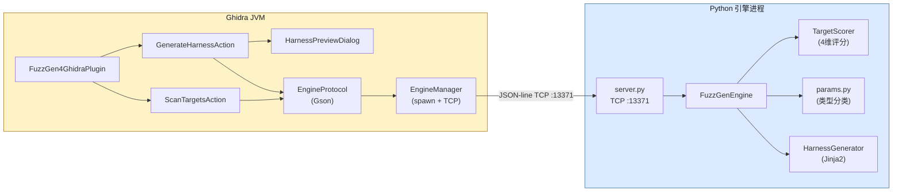
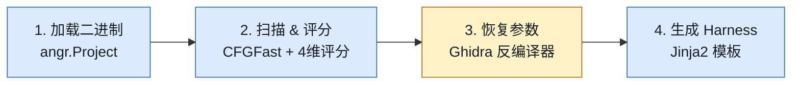
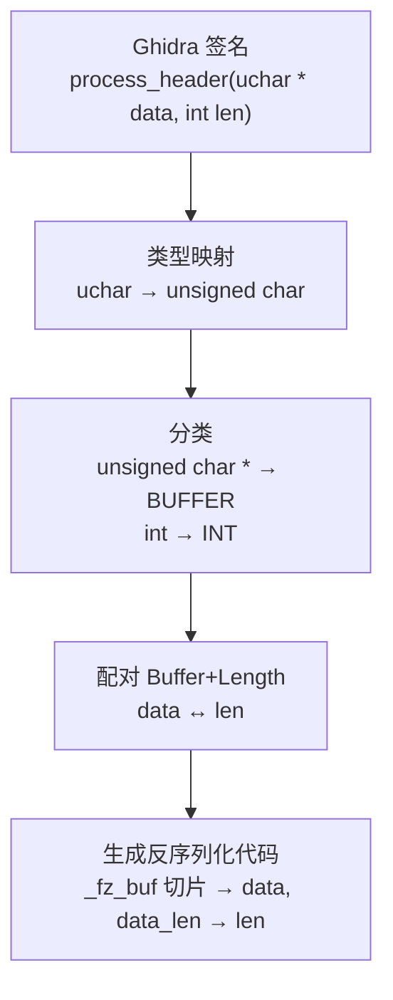

# FuzzGen4Ghidra

**基于 angr 的 Ghidra 自动化 Fuzzing Harness 生成插件。**

[English](README.md)

---

FuzzGen4Ghidra 是一个 Ghidra 扩展插件，能够自动为二进制函数生成 AFL++ 和 libFuzzer 的 fuzzing harness。它结合 Ghidra 反编译器的类型恢复能力和 angr 的二进制分析能力，生成可直接编译的 C 语言 harness 代码。

### 功能特性

- **目标评分** — 对二进制中的每个函数从 4 个维度评分：复杂度、输入面、危险调用、可行性
- **参数恢复** — 从 Ghidra 反编译器提取参数类型（buffer、int、结构体指针、函数指针）
- **Harness 生成** — 生成完整的 C harness 代码，包含输入反序列化、`dlopen`/`dlsym` 目标加载和 Makefile
- **双格式支持** — 同时支持 AFL++（基于文件）和 libFuzzer（`LLVMFuzzerTestOneInput`）两种 harness 风格
- **预览与导出** — Ghidra 内置预览对话框，支持语法高亮、格式切换、一键保存到目录

### 架构

> **交互式架构图**: [FuzzGen4Ghidra Architecture](https://claude.ai/artifact/Y1GPu6nQ324R8iweGPtK4B) — 包含详细的 Mermaid 流程图、评分示例、类型映射表和本地测试指南。

插件采用 **Java + Python 双进程**架构，通过 JSON-line TCP 协议通信（端口 13371）：



- **Java 侧**（Ghidra 插件）：UI 交互、反编译器调用、函数签名提取
- **Python 侧**（angr 引擎）：CFG 分析、目标评分、Jinja2 harness 代码生成
- **为什么分两个进程？** Ghidra 运行在 JVM 上，angr 是纯 Python 库。TCP 桥接避免了 JNI/Jython 的复杂性，同时允许引擎独立运行和测试。

### 处理流水线



| 步骤 | 处理内容 |
|------|---------|
| **1. 加载** | 插件通过 TCP 发送二进制路径。引擎创建 `angr.Project(path, auto_load_libs=False)`，返回架构和入口点 |
| **2. 扫描** | 引擎运行 `CFGFast()`，遍历 `project.kb.functions`，4 维评分。通过 `{"status":"progress"}` 流式推送进度 |
| **3. 参数** | Ghidra 的 `DecompInterface` 提取带类型的函数签名。引擎分类每个参数（`BUFFER`/`INT`/`STRUCT_PTR`/`FUNC_PTR`/`FLOAT`），并通过名称启发式配对 buffer+length 参数 |
| **4. 生成** | Jinja2 渲染完整 C harness，使用 `_fz_` 前缀的内部变量、Ghidra→C 类型映射、Makefile、类型头文件和种子语料 |

### 参数类型系统



| 参数类型 | 匹配 | Harness 行为 |
|---------|------|-------------|
| `BUFFER` | `void *`, `char *`, `uint8_t *`, `unsigned char *` | 消费剩余 fuzz 数据作为指针+长度 |
| `INT` | `int`, `uint32_t`, `size_t`, `undefined4`, ... | 通过 `consume_bytes()` 读取 N 字节 |
| `FLOAT` | `float`, `double` | 读取 `sizeof(type)` 字节 |
| `STRUCT_PTR` | 其他 `*` 类型（如 `kv_pair_t *`） | 分配 256 字节栈缓冲区，从 fuzz 数据填充 |
| `FUNC_PTR` | `code *` | 设为 `NULL` |

**Ghidra → C 类型映射**（Ghidra 非标准类型名到合法 C 类型）：

| Ghidra | C | Ghidra | C |
|--------|---|--------|---|
| `undefined` / `undefined1` | `uint8_t` | `uchar` | `unsigned char` |
| `undefined2` | `uint16_t` | `ushort` | `unsigned short` |
| `undefined4` | `uint32_t` | `uint` | `unsigned int` |
| `undefined8` | `uint64_t` | `byte` / `dword` | `uint8_t` / `uint32_t` |

指针类型拆分处理：`uchar *` → 基础类型 `uchar` → `unsigned char` + 后缀 ` *` → `unsigned char *`

### 评分机制

每个函数按 4 个加权维度评分（各 0-100 分）：

| 维度 | 权重 | 含义 |
|------|------|------|
| **输入面** | 30% | 是否有 buffer 参数、是否调用 `read`/`recv`/`fgets`、参数数量 |
| **复杂度** | 25% | 基本块数量（越多 = 越多路径可探索） |
| **危险度** | 25% | 是否调用 `memcpy`、`strcpy`、`sprintf`、`malloc`、`free` 等 |
| **可行性** | 20% | 是否为导出符号、是否有参数、调用深度 |

**真实评分示例**（libdemo.dylib）：

| 函数 | 评分 | 原因 |
|------|------|------|
| `parse_kv` | **54.0** | Buffer 参数 + `memcpy` + `strchr` + 中等复杂度 |
| `process_header` | **49.0** | Buffer 参数 + `memcpy` + 结构解析逻辑 |
| `url_decode` | 9.0 | 有参数但无危险调用 |
| `get_api_version` | 2.0 | 无参数，极简函数 |

### 安装

#### 1. 编译扩展

```bash
cd FuzzGen4Ghidra

JAVA_HOME=/path/to/jdk \
  gradle buildExtension \
  -PGHIDRA_INSTALL_DIR=/path/to/ghidra
```

产出：`dist/ghidra_*_FuzzGen4Ghidra.zip`

#### 2. 安装到 Ghidra

1. 打开 Ghidra → **File** → **Install Extensions**
2. 点击 **+** 按钮，选择 `.zip` 文件
3. 重启 Ghidra
4. 在 CodeBrowser 中：**File** → **Configure** → 勾选 **FuzzGen4Ghidra**

#### 3. 配置 Python 环境

```bash
python3 -m venv .venv
source .venv/bin/activate
pip install angr jinja2
```

插件会自动在父目录中查找 `.venv/bin/python3`。

### 使用方法

#### 为指定函数生成 harness

1. 在 Ghidra CodeBrowser 中打开二进制文件
2. 在 Listing 或 Decompiler 视图中定位到目标函数
3. **右键** → **FuzzGen4Ghidra** → **Generate Fuzz Harness**
4. 预览对话框中查看生成的 C 代码
5. 用下拉框切换 AFL++ / libFuzzer 格式
6. 点击 **Save to Directory** 导出 harness + Makefile + types.h + 种子文件

#### 扫描所有函数的 fuzz 目标

1. 菜单栏 → **FuzzGen4Ghidra** → **Scan Fuzz Targets**
2. 引擎对每个非平凡函数评分，返回排序列表
3. 查看每个目标的评分、基本块数、评分原因

### 完整使用教程

从安装到 fuzz 的每一步详细指引。

#### 第 1 步：编译并安装扩展

```bash
# 编译（替换为你实际的路径）
cd FuzzGen4Ghidra
JAVA_HOME=/Library/Java/JavaVirtualMachines/jdk-23.jdk/Contents/Home \
  gradle buildExtension \
  -PGHIDRA_INSTALL_DIR=$HOME/ghidra_11.4.3_PUBLIC

# zip 文件生成在 dist/ 目录
ls dist/ghidra_*_FuzzGen4Ghidra.zip
```

#### 第 2 步：安装到 Ghidra

1. 启动 Ghidra（在 Ghidra 安装目录运行 `ghidraRun`）
2. 在**项目窗口**中，打开 **File → Install Extensions...**
3. 点击右上角绿色的 **+** 按钮
4. 选择 `dist/ghidra_*_FuzzGen4Ghidra.zip`
5. 列表中出现 **FuzzGen4Ghidra** 并勾选
6. 点击 **OK**，根据提示**重启 Ghidra**

#### 第 3 步：配置 Python 引擎环境

```bash
# 在 FuzzGen4Ghidra 目录或其父目录创建 venv
cd FuzzGen4Ghidra
python3 -m venv .venv
source .venv/bin/activate
pip install angr jinja2
```

Java 插件会自动在项目目录及父目录中查找 `.venv/bin/python3`。

#### 第 4 步：导入二进制文件并启用插件

1. 在 Ghidra 项目窗口，**File → Import File...**
2. 选择要分析的二进制文件（如共享库 `libparser.so` 或 ELF 可执行文件）
3. 使用默认导入选项，点击 **OK**
4. 双击导入的文件，在 **CodeBrowser** 中打开
5. 提示 "Analyze now?" 时点击 **Yes**，接受默认分析器 — Ghidra 会运行自动分析（包括反编译）
6. 如果插件未启用：**File → Configure...**，找到 **FuzzGen4Ghidra** 并勾选

启用后会看到两个新功能入口：
- **右键菜单** → "FuzzGen4Ghidra" → "Generate Fuzz Harness"
- **菜单栏** → "FuzzGen4Ghidra" → "Scan Fuzz Targets"

#### 第 5 步：扫描 fuzz 目标

1. 在 CodeBrowser 菜单栏：**FuzzGen4Ghidra → Scan Fuzz Targets**
2. 插件自动启动 Python 引擎（首次运行可能需要几秒）
3. 进度对话框显示 angr CFG 分析进度
4. 完成后弹出结果表格，展示按评分排序的 Top-20 目标函数
5. 每行包含：函数名、地址、综合评分、基本块数、评分原因

利用此结果找到最适合 fuzz 的函数 — 关注高分且包含危险调用（`memcpy`、`strcpy` 等）和 buffer 参数的函数。

#### 第 6 步：生成 fuzz harness

1. 在 **Listing** 或 **Decompiler** 视图中，点击目标函数
2. **右键 → FuzzGen4Ghidra → Generate Fuzz Harness**
3. 弹出 **Harness Preview** 对话框，展示生成的 C 源码
4. 用顶部 **Format** 下拉框切换格式：
   - **afl** — 生成 `main()` 函数从文件读取输入（适用 AFL++）
   - **libfuzzer** — 生成 `LLVMFuzzerTestOneInput()`（适用 libFuzzer/LLVM）
5. 点击 **Copy to Clipboard** 复制代码，或
6. 点击 **Save to Directory...** 将全部文件导出到一个目录：
   - `harness_<函数名>.c` — harness 源码
   - `types.h` — 目标函数参数的类型定义
   - `Makefile` — 可直接使用的构建文件
   - `seeds/seed_000` — 初始种子语料文件

#### 第 7 步：编译并运行 fuzzer

```bash
cd output_dir/

# AFL++ 模式：
make           # 用 afl-gcc + ASan 编译
make fuzz      # 启动 afl-fuzz，使用生成的种子语料

# libFuzzer 模式：
# （在预览对话框中切换为 "libfuzzer" 格式，重新保存）
make           # 用 clang -fsanitize=fuzzer,address 编译
make fuzz      # 启动 libFuzzer
```

#### 常见问题（FAQ）

**Q: "Failed to load binary: No module named 'angr'"**

插件找到了 Python 解释器，但该 Python 没有安装 angr。两种解决方案：

1. **设置 `FUZZGEN_PYTHON` 环境变量**（推荐）：在启动 Ghidra 前指定正确的 venv Python：
   ```bash
   export FUZZGEN_PYTHON="/path/to/.venv/bin/python3"
   /path/to/ghidra/ghidraRun
   ```
2. **手动启动引擎** — 插件会自动连接到已运行的引擎：
   ```bash
   cd FuzzGen4Ghidra
   PYTHONPATH=python /path/to/.venv/bin/python3 -m fuzzgen4ghidra_engine -v
   # 然后在 Ghidra 中正常使用插件
   ```

**Q: "Binary not loaded — call init first"**

你在**项目窗口**而不是 **CodeBrowser** 中触发了扫描。先双击二进制文件在 CodeBrowser 中打开，然后再使用插件。

**Q: 手动启动引擎时报 "Address already in use"**

端口 13371 被旧进程占用，先杀掉：
```bash
lsof -ti :13371 | xargs kill
```

**Q: libFuzzer harness 链接失败：`libclang_rt.fuzzer_osx.a not found`**

macOS 自带的 Apple Clang 不包含 libFuzzer 运行时。需要安装 Homebrew LLVM：
```bash
brew install llvm
/opt/homebrew/opt/llvm/bin/clang -fsanitize=fuzzer,address -o harness harness.c -ldl
```

**Q: AFL harness 编译失败：`afl-gcc: No such file or directory`**

未安装 AFL++。安装方法：
```bash
brew install aflplusplus
```
或在预览对话框中切换为 libFuzzer 格式（只需 LLVM clang，无需 AFL++）。

**Q: Harness 编译成功但运行时 `dlopen` 报错**

目标库必须在 harness 同目录下（或在 `dlopen` 可查找的路径中）：
```bash
cp /path/to/target.so ./   # 复制到 harness 同目录
```

| 其他问题 | 解决方案 |
|---------|----------|
| 引擎启动很慢 | angr 的 CFG 分析是 CPU 密集型的，大型二进制文件需要更多时间 |
| 扫描未发现函数 | 二进制可能被 strip 了或没有导出函数，尝试使用共享库 |
| "Generate Fuzz Harness" 灰色不可点 | 确保光标在 Listing/Decompiler 视图中的某个函数内部 |

### 本地手动测试（不需要 Ghidra）

可以从命令行测试整个流水线，完全绕过 Ghidra。

#### 1. 启动引擎

```bash
cd FuzzGen4Ghidra
PYTHONPATH=python .venv/bin/python3 -m fuzzgen4ghidra_engine -v
# → Listening on 127.0.0.1:13371
```

#### 2. 通过 nc 发送命令

```bash
# 加载二进制
echo '{"type":"init","params":{"binary_path":"/path/to/libdemo.dylib"}}' | nc 127.0.0.1 13371

# 扫描目标
echo '{"type":"scan_targets","params":{"ghidra_functions":[]}}' | nc 127.0.0.1 13371

# 生成 harness（使用 Ghidra 风格的签名）
echo '{"type":"generate_harness","params":{
  "func_addr":"0x5f0",
  "func_name":"process_header",
  "ghidra_signature":{"params":[
    {"name":"data","type":"uchar *","size":8},
    {"name":"len","type":"int","size":4}
  ]},
  "format":"libfuzzer"
}}' | nc 127.0.0.1 13371
```

#### 3. 编译 harness

```bash
cd output_dir/
cp /path/to/libdemo.dylib ./   # 目标库必须在同目录

# 方案 A: 完整 libFuzzer（需要 Homebrew LLVM）
/opt/homebrew/opt/llvm/bin/clang -fsanitize=fuzzer,address -o harness harness_*.c -ldl

# 方案 B: Apple Clang + 独立 driver（无需 LLVM）
cat > main_driver.c << 'DRIVER'
#include <stdio.h>
#include <stdlib.h>
#include <stdint.h>
extern int LLVMFuzzerTestOneInput(const uint8_t *data, size_t size);
int main(int argc, char **argv) {
    if (argc < 2) { fprintf(stderr, "Usage: %s <input>\n", argv[0]); return 1; }
    FILE *f = fopen(argv[1], "rb");
    if (!f) { perror("fopen"); return 1; }
    fseek(f, 0, SEEK_END); long len = ftell(f); fseek(f, 0, SEEK_SET);
    uint8_t *buf = malloc(len); fread(buf, 1, len, f); fclose(f);
    int r = LLVMFuzzerTestOneInput(buf, len);
    printf("returned %d\n", r); free(buf); return 0;
}
DRIVER

clang -g -O0 -fsanitize=address,undefined -fno-omit-frame-pointer \
  -o harness harness_*.c main_driver.c -ldl
```

#### 4. 构造测试输入并验证

```bash
# 构造测试输入（以 process_header 协议为例）
python3 -c "
import struct
magic = b'\xDE\xAD\xBE\xEF'
v = b'\x01'
# 安全输入：payload_len=100，在 buffer[512] 内
open('test_ok.bin','wb').write(magic + v + struct.pack('<H', 100) + b'A'*100)
# 溢出输入：payload_len=1000，超出 buffer[512]
open('test_crash.bin','wb').write(magic + v + struct.pack('<H', 1000) + b'B'*1000)
"

# 运行
./harness test_ok.bin        # → returned 0（正常）
./harness test_crash.bin     # → ASan: stack-buffer-overflow!
```

**溢出输入的预期 ASan 输出：**
```
ERROR: AddressSanitizer: stack-buffer-overflow on address ...
WRITE of size 1000 at ... thread T0
    #0 ... in __asan_memcpy
    #1 ... in process_header demo.c:17
    #2 ... in LLVMFuzzerTestOneInput harness_process_header.c:49
```

> **注意：** 目标库也需要用 ASan 编译（`clang -shared -fsanitize=address -o libdemo.dylib demo.c`），否则 ASan 无法检测到库内部的栈溢出。

### 演示：从生成到 fuzzing

```bash
# 1. 在 Ghidra 中右键 parse_packet → Generate Fuzz Harness
#    → Save to Directory → 选择 output/

# 2. 编译并开始 fuzz
cd output/
make           # 用 afl-gcc + ASan 编译
make fuzz      # 启动 afl-fuzz，使用自动生成的种子语料

# 3. 或者用 libFuzzer
# 在预览对话框中切换格式为 libfuzzer，重新保存
make           # 用 clang -fsanitize=fuzzer 编译
make fuzz      # 启动 libFuzzer
```

### PoC：栈溢出利用演示

`demo/` 目录包含完整的漏洞利用 PoC，演示 `process_header` 栈溢出的 4 个升级阶段：

| 级别 | 操作 | 结果 |
|------|------|------|
| **1. 正常** | payload_len=100，在 buffer[512] 内 | 正常返回 |
| **2. 溢出** | payload_len=600，越界写 88 字节 | SIGSEGV — 返回地址被破坏 |
| **3. 控制跳转** | 返回地址被写为 `0x4141414141414141` | SIGSEGV — CPU 跳转到攻击者指定的地址 |
| **4. 任意代码执行** | 返回地址被写为 `&you_got_pwned` | 攻击者的函数被执行 |

```bash
cd demo/
make          # 编译 libdemo.dylib（无保护）+ poc_exploit
make poc      # 运行 4 级 PoC 演示
```

#### PoC 原理详解

**漏洞代码：**
```c
int process_header(const unsigned char *data, int len) {
    uint16_t payload_len = data[5] | (data[6] << 8);  // 攻击者控制，0-65535
    char decompressed[512];                             // 固定大小栈缓冲区
    memcpy(decompressed, data + 7, payload_len);        // ← 漏洞：无边界检查
}
```

**x86_64 栈布局（-O0，无栈保护）：**
```
           低地址
           ┌─────────────────────┐
  rbp-544  │ decompressed[0..511]│  ← memcpy 目标
           │     (512 字节)      │
           ├─────────────────────┤
  rbp-32   │ 局部变量             │  ← version, payload_len 等
           ├─────────────────────┤
  rbp      │ saved RBP           │  ← 调用者的栈帧指针 (8 字节)
           ├─────────────────────┤
  rbp+8    │ 返回地址             │  ← ret 指令跳转目标 (8 字节)
           └─────────────────────┘
           高地址
```

缓冲区起始到返回地址 = **552 字节**。

**Level 4 的 payload 构造：**
```
数据包: [DE AD BE EF] [01] [30 02] [00×552 字节] [you_got_pwned 地址, 8 字节]
        magic          ver  len=560  填充到返回地址   覆盖返回地址

process_header 执行 ret 时：
  1. CPU 从栈上弹出返回地址 → 得到 &you_got_pwned
  2. CPU 跳转到 you_got_pwned()
  3. 攻击者的代码以进程权限运行
```

**为什么用 fork() 隔离？** 栈溢出破坏了栈本身，`longjmp`/信号处理器无法恢复。PoC 用 `fork()` 在子进程中运行每次尝试，父进程通过 `waitpid()` 检查退出码：0=正常返回，42=`you_got_pwned` 被执行，signal 11=SIGSEGV。

**修复方法：** `if (payload_len > sizeof(decompressed)) return -1;`

### SO 审计 Demo（Android/Linux 动态库）

`demo/so_audit/` 包含一个模拟 Android/Linux native 库，涵盖 5 种常见漏洞模式：

| # | 函数 | 漏洞类型 | 严重度 |
|---|------|---------|--------|
| 1 | `native_parse_config` | 栈溢出（sscanf 无边界检查） | CRITICAL |
| 2 | `native_process_image` | 整数溢出→堆溢出 | CRITICAL |
| 3 | `native_log_event` | 格式化字符串 | HIGH |
| 4 | `native_decrypt_blob` | Use-After-Free | HIGH |
| 5 | `native_exec_cmd` | 命令注入 | CRITICAL |

```bash
cd demo/so_audit/
make          # 编译库 + 审计程序
make audit    # 运行自动化漏洞触发
make asan     # ASan 模式（检测 UAF 和堆溢出）
```

**审计 .so 文件的工作流：**
1. 从 APK 中提取 `lib/arm64-v8a/*.so`（`unzip -d apk_contents app.apk`）
2. 在 Ghidra 中加载 `.so` 并分析
3. 运行 **Scan Fuzz Targets** → 查看评分排序
4. 对高分函数 → **Generate Fuzz Harness**
5. 编译 harness + ASan → 开始 fuzzing

### 测试

```bash
# 单元测试（不需要 angr）
PYTHONPATH=python python -m pytest test/ -v --ignore=test/test_integration.py

# 完整测试（需要 angr venv）
PYTHONPATH=python .venv/bin/python3 -m pytest test/ -v
# 25 passed ✓
```

### 许可证

Apache 2.0
